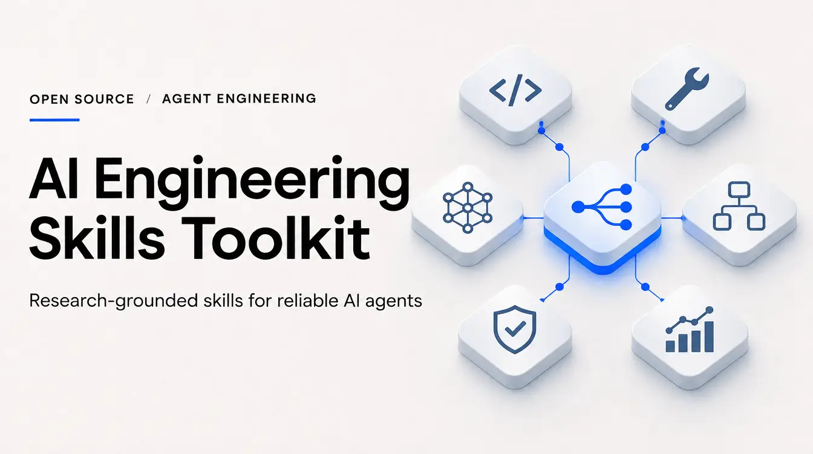

# Advanced AI Engineering Skills

AAES is a catalog of **28 portable [Agent Skills](https://agentskills.io/specification)** for designing, evaluating, and operating AI systems. Each skill gives a coding agent a procedure for a specific engineering task, plus examples and a technical reference. Many include a local Python helper that checks a contract or analyzes an artifact.

Use AAES for repository and tool design, trace analysis, evaluations, context and inference planning, durable execution, and security review. The local helpers use the Python standard library. Live model, provider, and GPU experiments require their own environment.

[Quick start](#quick-start) · [Skill catalog](#skill-catalog) · [Running the helpers](#running-the-helpers) · [Validation and production use](#validation-and-production-use)

## Quick start

Clone the repository or [download the source archive](https://github.com/ognistie/AI-Engineering-Skills-Toolkit/archive/refs/heads/main.zip). The repository installer requires **Python 3.12+**. Run the commands from the repository root.

```sh
git clone https://github.com/ognistie/AI-Engineering-Skills-Toolkit.git
cd AI-Engineering-Skills-Toolkit
```

Start with one skill. The commands below install `process-verifier`.

| Host | Windows PowerShell | macOS / Linux |
| --- | --- | --- |
| Codex | `.\scripts\install.ps1 -Target codex -Skill process-verifier` | `sh scripts/install.sh codex process-verifier` |
| Claude Code | `.\scripts\install.ps1 -Target claude -Skill process-verifier` | `sh scripts/install.sh claude process-verifier` |

Omit the skill argument to install the full catalog. For custom destinations, updates, or agent-assisted installation, see the [installation guide](INSTALL.md). Hosts that import Agent Skills archives can use the [individual ZIPs](dist/).

Open a new agent session and invoke the installed skill explicitly:

```text
Codex:       $process-verifier Check the release criteria against the supplied CI logs. Cite the evidence for each gate and mark missing evidence as inconclusive.
Claude Code: /process-verifier Check the release criteria against the supplied CI logs. Cite the evidence for each gate and mark missing evidence as inconclusive.
```

Give the agent the **outcome**, **inputs** (files, traces, or logs), **constraints** (for example, read-only), and **expected output**. If you are unsure which skill fits, ask `skill-orchestrator` to recommend one and explain its choice before any execution.

## Skill catalog

Each link opens the skill's instructions and references. The last column is an example task to put after `$skill-name` in Codex or `/skill-name` in Claude Code.

### Routing, research, and verification

| Skill | When to use it | Example request |
| --- | --- | --- |
| [skill-orchestrator](skills/skill-orchestrator/SKILL.md) | Choose the smallest set of skills that covers a task within its constraints. | Recommend skills for investigating this failed agent run. Explain the choice and keep the work read-only. |
| [research-orchestrator](skills/research-orchestrator/SKILL.md) | Compare options using primary sources and trace claims to evidence. | Compare two approaches to durable execution for this workflow. Link the evidence, separate measurements from assumptions, and propose a test. |
| [process-verifier](skills/process-verifier/SKILL.md) | Check whether a workflow met fixed acceptance criteria using independent observations. | Compare the release criteria with these CI logs and the final artifact. Mark each gate passed, failed, or inconclusive. |
| [trajectory-analyzer](skills/trajectory-analyzer/SKILL.md) | Reconstruct the timing and dependencies of an agent run from its spans. | Use this trace to identify the longest waits and repeated operations. Separate elapsed time from overlapping span durations. |
| [experiment-evaluator](skills/experiment-evaluator/SKILL.md) | Compare a baseline and candidate with paired trials and a fixed protocol. | Compare these paired runs for success, latency, and cost. Apply the quality floor and show missing pairs separately. |

### Repositories and tool interfaces

| Skill | When to use it | Example request |
| --- | --- | --- |
| [agent-first-harness](skills/agent-first-harness/SKILL.md) | Audit whether agents can navigate a repository, find commands, and verify their work. | Review this repository's agent instructions, build and test entry points, and feedback loop. Report missing evidence without running commands. |
| [repository-context-architecture](skills/repository-context-architecture/SKILL.md) | Organize canonical documentation and find broken links, duplicates, or stale references. | Map the architecture and runbook docs. Flag duplicate topics and broken links, then propose a concise navigation index. |
| [agent-computer-interface](skills/agent-computer-interface/SKILL.md) | Review one agent tool's schema, arguments, and recovery messages. | Check this tool schema against the valid and invalid calls. Identify ambiguous fields and suggest actionable errors. |
| [agent-tool-interface-design](skills/agent-tool-interface-design/SKILL.md) | Design discovery for a large tool catalog under access and context constraints. | From this catalog, shortlist tools allowed for a read-only customer lookup. Stay within the schema byte budget. |

### Context and inference

| Skill | When to use it | Example request |
| --- | --- | --- |
| [kv-cache-aware-context](skills/kv-cache-aware-context/SKILL.md) | Diagnose unstable prompt prefixes and evaluate opportunities for cache reuse. | Compare these serialized requests. Show where their common prefix breaks and report provider cache metrics only if supplied. |
| [context-compaction-recovery](skills/context-compaction-recovery/SKILL.md) | Verify that a shortened context preserves constraints, evidence, and the next step. | Compare the restored checkpoint with the original. Flag missing constraints, changed artifact hashes, and unresolved errors. |
| [inference-serving-architect](skills/inference-serving-architect/SKILL.md) | Estimate memory and plan experiments for self-hosted model serving. | Given this model and GPU configuration, estimate KV capacity and design a matched test of colocated versus split prefill and decode. |

### Agent evaluations and experiments

| Skill | When to use it | Example request |
| --- | --- | --- |
| [agent-evals-engineer](skills/agent-evals-engineer/SKILL.md) | Design or score agent evaluations against independently collected final states. | Use these frozen trial IDs and the trusted outcome ledger to compute pass@1, pass@k, and pass^k. Report missing evidence separately. |
| [trajectory-review-engine](skills/trajectory-review-engine/SKILL.md) | Inspect ordered events for invalid calls, stalled loops, or disagreement with the final state. | Review the event sequence for repeated failures without progress. Check whether the agent's success claim matches the observed outcome. |
| [evaluator-optimizer-loop](skills/evaluator-optimizer-loop/SKILL.md) | Decide whether another revision of one artifact is worth the remaining budget. | Given this rubric and iteration history, retain the best verified artifact and explain whether to stop or revise again. |
| [evolutionary-optimizer](skills/evolutionary-optimizer/SKILL.md) | Compare a population of candidate variants against objectives and hard limits. | Rank the feasible variants by quality and latency. Keep the holdout separate and identify which candidates merit more trials. |
| [hypothesis-lab](skills/hypothesis-lab/SKILL.md) | Separate competing explanations and design a test that distinguishes them. | Given these traces, propose competing causes for the slowdown and the smallest experiment that would distinguish them. |
| [mechanistic-interpretability](skills/mechanistic-interpretability/SKILL.md) | Design or analyze controlled interventions in neural activations. | Analyze these clean, corrupted, and patched measurements. Compare restoration with the negative control and state what the data supports. |
| [agentic-rl-lab](skills/agentic-rl-lab/SKILL.md) | Specify and test a tool-use reinforcement-learning environment and reward rules. | Check these trusted rollouts for invalid transitions and unsafe actions, then calculate discounted returns without training a policy. |

### Planning, delegation, and recovery

| Skill | When to use it | Example request |
| --- | --- | --- |
| [adaptive-reasoning](skills/adaptive-reasoning/SKILL.md) | Decide whether to continue, verify, escalate, or stop under fixed budgets. | Given the evidence and the remaining time, attempt, and cost limits, choose the next useful check or explain why to stop. |
| [multi-agent-router](skills/multi-agent-router/SKILL.md) | Decide whether work can be delegated safely and whether parallelism is worth the overhead. | Group these tasks by dependency and file ownership. Compare serial and parallel plans without dispatching agents. |
| [long-horizon-executor](skills/long-horizon-executor/SKILL.md) | Plan milestones and restore progress from verified checkpoints. | Review this checkpoint and identify the first safe step to resume. Do not repeat an operation whose effect is uncertain. |
| [durable-execution-engine](skills/durable-execution-engine/SKILL.md) | Decide how to reconcile, retry, or compensate an interrupted side effect. | Given this journal snapshot and missing provider receipt, explain whether to reconcile or retry under the attempt and deadline limits. |
| [brain-tool-runtime-separation](skills/brain-tool-runtime-separation/SKILL.md) | Design the boundary between model proposals and a trusted executor. | Validate this proposed action plan against trusted resource scopes. Demonstrate rejection of an unauthorized action using only simulated handlers. |

### Security and runtime verification

| Skill | When to use it | Example request |
| --- | --- | --- |
| [runtime-guardian](skills/runtime-guardian/SKILL.md) | Design or simulate an external policy gate for a concrete tool action. | Evaluate this proposed publish action against the resource scope, approval expiry, and budget. Do not publish anything. |
| [capability-security-architect](skills/capability-security-architect/SKILL.md) | Review whether delegated permissions stay within the original grant. | Compare this child grant with the parent. Flag any expanded resource, effect, or expiry. |
| [prompt-injection-boundaries](skills/prompt-injection-boundaries/SKILL.md) | Review whether untrusted data can cross a privileged boundary. | Given the executor's trusted artifact digest and source list, check whether this output may go to the public destination. Test an omitted source. |
| [runtime-verification-engine](skills/runtime-verification-engine/SKILL.md) | Replay a workflow to check allowed transitions, duplicate events, and budget limits. | Replay these events against the transition policy. Return the first violation, last valid state, and spend at that point. |

## Running the helpers

Each skill's `SKILL.md` links to its operating contract, worked cases, and research basis. To try a deterministic check without an agent, run this bundled fixture from the repository root:

```sh
python skills/agent-computer-interface/scripts/check.py evals/production-fixtures/agent-computer-interface.json
```

The JSON report contains the tool-contract findings and the validity of each example call. Use the [ACI operating contract](skills/agent-computer-interface/references/TECHNICAL_GUIDE.md) to prepare your own input. Other helpers have their own command and schema in their technical guides.

## Validation and production use

The [0.2.0 audit and revalidation](audit/production-ai-engineering/REMEDIATION.md) records **61 tests, 181 structured routing cases, 28 audit controls, and 28 ZIPs** checked against their sources. These checks cover local behavior and packaging. They do not establish automatic activation in a host, consistent gains in model quality or cost, or production safety.

- **Daily development:** use skills for planning, review, local checks, and trace analysis. Start read-only when inspecting unfamiliar repositories or production evidence.
- **Real side effects:** the system that executes the action must enforce permissions, resource scope, approvals, and the exact artifact or request at dispatch. Test that integration in staging before automating deployments, deletions, payments, or data export.
- **Quality gates:** collect final-state evidence outside the evaluated agent's write scope. Keep local demonstrations and estimates separate from measured production outcomes.

[Architecture](docs/ARCHITECTURE.md) · [Compatibility](docs/COMPATIBILITY.md) · [Security model](docs/SECURITY.md) · [Release history](CHANGELOG.md)
